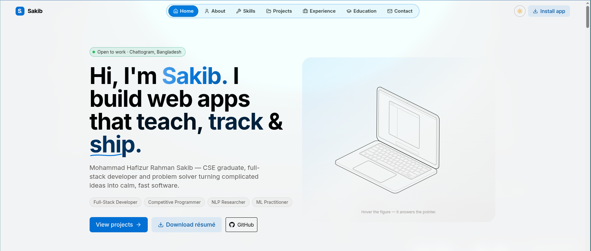

<div align="center">

# Sakib — Portfolio

**Full-stack developer · Competitive programmer · NLP researcher**
Chattogram, Bangladesh

[**🌐 Live site**](https://arch-sakib.vercel.app/) · [Features](#highlights) · [Getting started](#getting-started) · [Routes](#routes) · [Deployment](#deployment)


<br />

<a href="https://arch-sakib.vercel.app/">
  
</a>

</div>

A fast, responsive, installable personal portfolio. Light by default, with an animated dark mode, interactive line-art figures and a working contact form.

---

## Highlights

- **Light by default, dark on demand.** First-time visitors always get the light theme. The sun/moon switch reveals the dark theme as a circle growing from the button (View Transitions API, with a soft cross-fade fallback and full `prefers-reduced-motion` support). The choice is remembered on the device and applied before first paint, so there is no flash.
- **Responsive on every screen.** A centered pill navbar with icons on desktop (1280px and up), a floating rounded tab bar on tablets and phones, and a pill-style footer. Checked from 280px foldables to 4K TVs, with safe-area support for notched phones.
- **Installable PWA.** Offline-first service worker, web manifest, maskable icons and an in-page *Install app* button (with step-by-step help on iOS).
- **Interactive figures.** Hairline line-art illustrations that react to the pointer, tuned to both themes.
- **Rich details.** Animated hero heading, brand icons on skills and project tags, scroll-reveal sections, and a downloadable résumé.
- **Working contact form.** Sends through Web3Forms with loading, success and error states.
- **Clean section URLs.** Navbar links open `/about`, `/skills`, `/projects` and so on, with no `#` in the address. Old `/#about` links are redirected to `/about`.
- **Custom 404 page** for any path that is not `/` or one of the section routes.

## Tech stack

| Area | Tools |
| --- | --- |
| Framework | React 18, Vite 6 |
| Styling | Tailwind CSS 3, CSS variables for theming, Inter (variable font) |
| Figures | [`@lucasmarkes/hairline`](https://www.npmjs.com/package/@lucasmarkes/hairline) |
| Icons | `lucide-react`, `react-icons` (brand logos) |
| Forms | [Web3Forms](https://web3forms.com) |
| PWA | Web manifest, custom service worker |
| Hosting | Vercel (any static host that serves `/` for all routes works) |

## Getting started

**Requirements:** Node.js 18 or newer.

```bash
# 1. install dependencies
npm install

# 2. start the dev server
npm run dev

# 3. production build + local preview
npm run build
npm run preview
```

> The service worker only runs on the production build, so use `npm run build && npm run preview` to test the PWA and offline mode.

## Project structure

```text
hafiz-landing/
├── index.html                 # meta tags, theme-color, no-flash theme script
├── tailwind.config.js         # colour tokens (mapped to CSS variables), shadows, fonts
├── vercel.json                # rewrites every path to the app (needed for /about etc.)
├── docs/
│   └── screenshot.png         # preview image used in this README
├── public/
│   ├── Hafiz-Sakib-CV.pdf     # résumé download
│   ├── manifest.webmanifest   # PWA manifest
│   ├── sw.js                  # service worker (bump VERSION on big releases)
│   ├── _redirects             # Netlify-style fallback
│   └── icon-*.png, favicon-*  # app and browser icons
└── src/
    ├── main.jsx               # entry point, service worker registration
    ├── App.jsx                # composes the sections (+ 404 check, global hooks)
    ├── index.css              # theme tokens (light + dark), animations, components
    ├── usePwaInstall.jsx      # install-prompt state (Android/desktop/iOS)
    ├── TabBar.jsx             # mobile / tablet docked tab bar
    ├── sections/              # one file per page section, each with its own content data
    │   ├── Nav.jsx  Hero.jsx  About.jsx  Focus.jsx  Skills.jsx  Principles.jsx
    │   ├── Projects.jsx  Numbers.jsx  Education.jsx  Experience.jsx
    │   └── Contact.jsx  Footer.jsx  NotFound.jsx
    ├── components/            # reusable pieces (Reveal, SectionHead, TechTag, Timeline, ...)
    ├── hooks/                 # useTheme, useActiveSection, useSectionRouting, ...
    ├── data/                  # shared data: site.js (EMAIL, LINKS, NAV), tech.js, projects.js
    ├── lib/                   # routing.js (clean-URL helpers), motion.js
    └── assets/                # profile photo and project screenshots
```

## Customising

Content lives next to the section that shows it, or in `src/data/` when it is shared:

| What | Where |
| --- | --- |
| Email, social links, résumé path, nav items | `EMAIL`, `LINKS`, `NAV` in `src/data/site.js` |
| Social buttons in the contact card | `SOCIALS` in `src/sections/Contact.jsx` |
| Intro facts (location, degree, work) | `FACTS` in `src/sections/About.jsx` |
| What I do | `FOCUS` in `src/sections/Focus.jsx` |
| Skills | `SKILLS` in `src/sections/Skills.jsx` |
| Projects | `PROJECTS` in `src/data/projects.js` |
| Stats | `STATS` in `src/sections/Numbers.jsx` |
| Jobs | `JOBS` in `src/sections/Experience.jsx` |
| Education, certificates, publications | `EDU`, `CERTS`, `PUBS` in `src/sections/Education.jsx` |
| Icons for skill and project tags | `TECH` in `src/data/tech.js` (name → icon and colours) |
| Hero heading words, role chips | `HEADING`, `ROLES` in `src/sections/Hero.jsx` |

**Adding a project:** add an object to `PROJECTS` (`src/data/projects.js`) and drop its screenshot into `src/assets/`. Tag names that exist in `TECH` automatically get their icon.

**Adding a tech icon:** import it from `react-icons` (or `lucide-react`) and add one line to `TECH` in `src/data/tech.js`, for example `"Svelte": [SiSvelte, "#ff3e00"]`. An optional third value sets a lighter colour for dark mode.

### Theming

Colours are CSS variables defined in `src/index.css` (`:root` for light, `.dark` for dark) and exposed to Tailwind in `tailwind.config.js`, so utilities such as `bg-surface`, `text-ink-muted` and `border-line` switch themes automatically. To restyle a theme, change the variables, not the components.

- The default theme is light. The visitor's choice is stored in `localStorage` under `sakib-theme`.
- Figure colours for each theme are set in the `.fig` rules in `src/index.css`.
- The browser `theme-color` is updated when the theme changes.

## Routes

The site is a single page. Each section has its own clean URL that scrolls to that section (smooth scroll on click, back/forward supported):

| URL | Section |
| --- | --- |
| `/` | Home |
| `/about` | About |
| `/skills` | Skills |
| `/projects` | Projects |
| `/experience` | Experience |
| `/education` | Education |
| `/contact` | Contact |

Any other path shows the custom 404 page. Routes are listed in `SECTION_PATHS` in `src/lib/routing.js`; to add a section, create `src/sections/<Name>.jsx` with an `id`, render it in `src/App.jsx`, and add it to `NAV` (`src/data/site.js`) and `SECTION_PATHS`.

> Direct visits to `/about` work only because the host serves `index.html` for every path. That is already configured in `vercel.json` (Vercel) and `public/_redirects` (Netlify).

## Contact form

The form posts to Web3Forms. To use your own access key, create a `.env` file:

```bash
VITE_WEB3FORMS_KEY=your-access-key
```

Restart the dev server after changing it. For production, set the same variable in your hosting dashboard.

## Deployment

1. Push the repository to GitHub.
2. Import it into [Vercel](https://vercel.com) (or Netlify). Framework preset: **Vite**, build command `npm run build`, output directory `dist`.
3. Add `VITE_WEB3FORMS_KEY` in the project's environment variables if you use your own key.
4. Deploy. PWA installation requires HTTPS, which these hosts provide by default.

`vercel.json` and `public/_redirects` make sure every path is served by the app, which is what lets section URLs like `/about` and the custom 404 page work. The live site is deployed at [arch-sakib.vercel.app](https://arch-sakib.vercel.app/).

**After a release:** if returning visitors do not see your changes, bump `VERSION` in `public/sw.js` (for example `v3` to `v4`) so the old cache is replaced.

## Credits

- Interactive figures by [Hairline](https://www.npmjs.com/package/@lucasmarkes/hairline).
- Design language inspired by Notion.
- Icons from [Lucide](https://lucide.dev) and [Simple Icons](https://simpleicons.org) via `react-icons`.
- Typeface: [Inter](https://rsms.me/inter/).

## Contact

**Mohammad Hafizur Rahman Sakib**

- Email: [hafizsakib5@gmail.com](mailto:hafizsakib5@gmail.com)
- GitHub: [Hafiz-Sakib](https://github.com/Hafiz-Sakib)
- LinkedIn: [hafiz-sakib](https://www.linkedin.com/in/hafiz-sakib-96b8b3229/)
- Codeforces: [hafiz_sakib](https://codeforces.com/profile/hafiz_sakib)
- LeetCode: [hafiz_Sakib](https://leetcode.com/hafiz_Sakib/)
